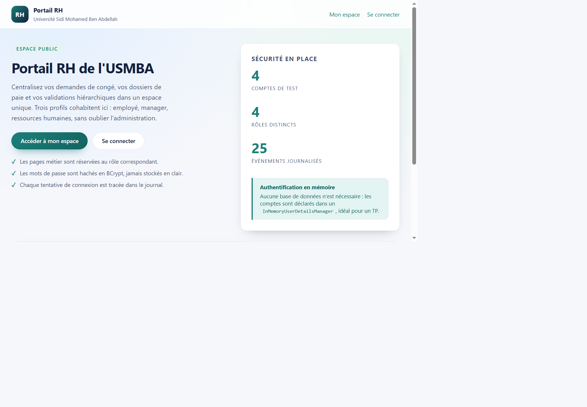
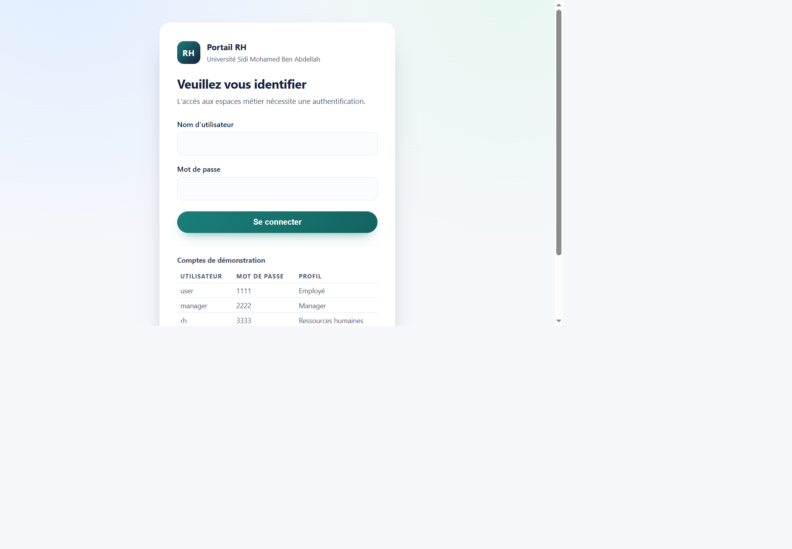
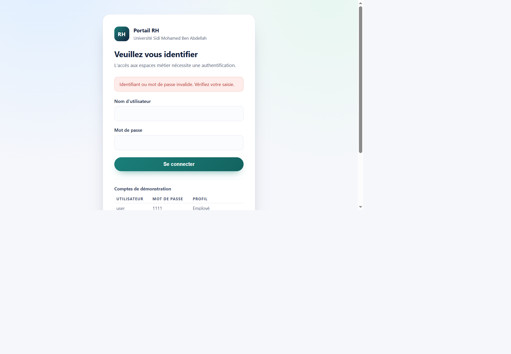
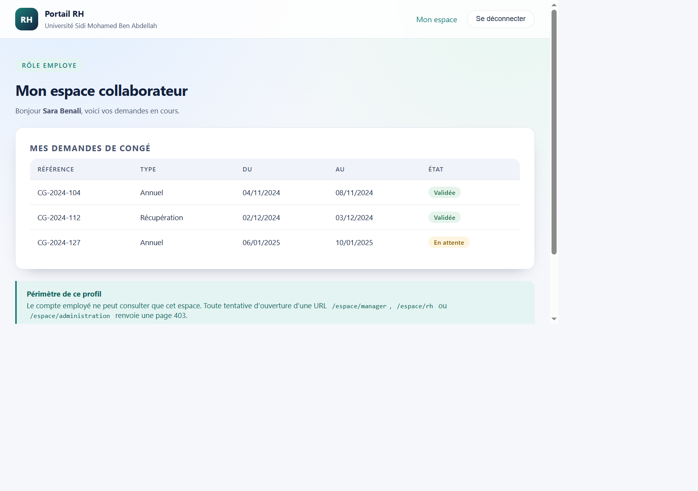
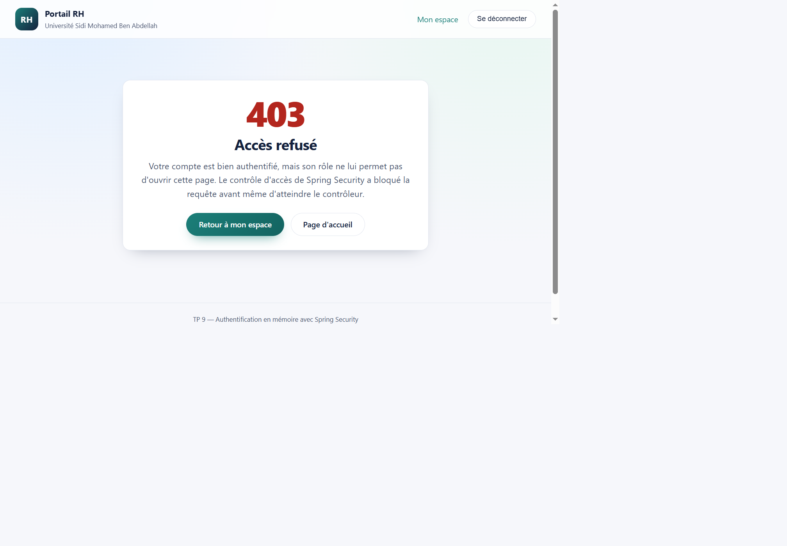
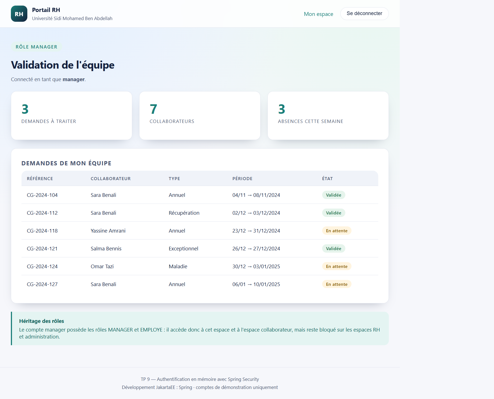
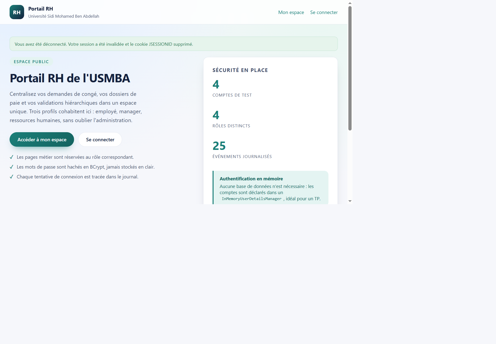
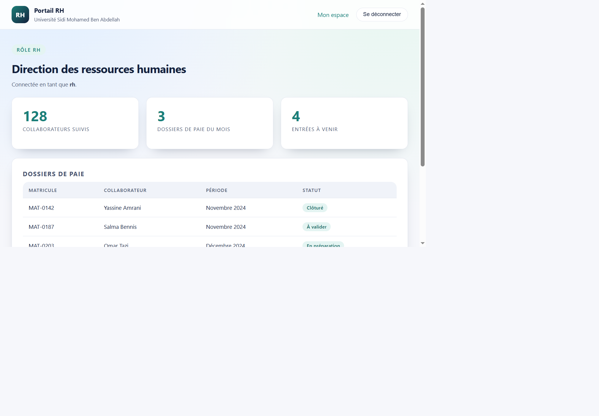
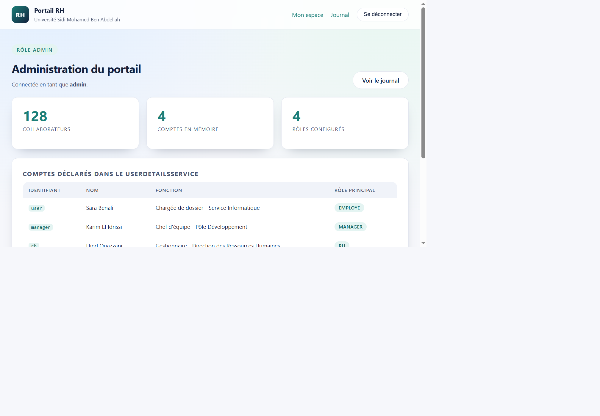
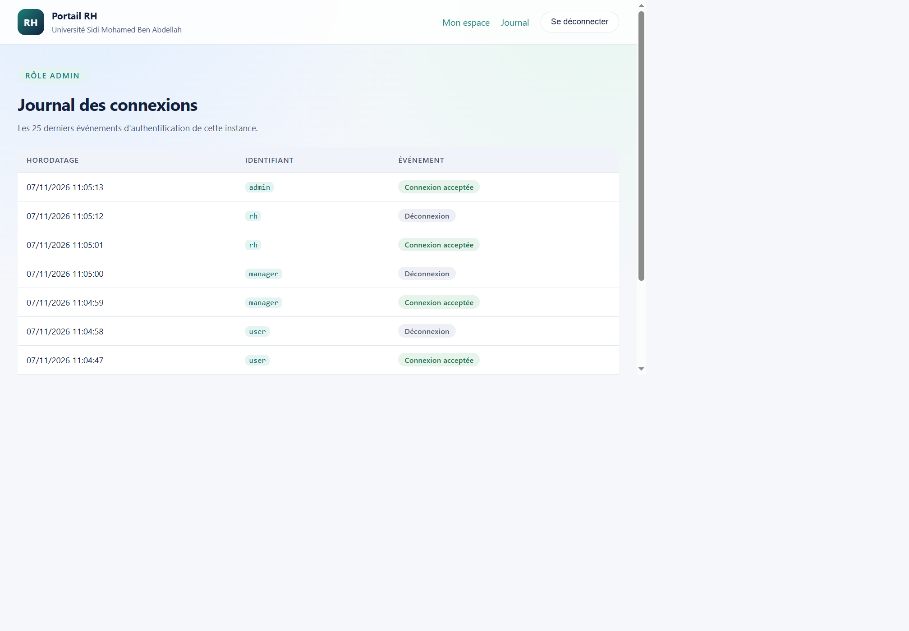

# TP 9 — Authentification en mémoire avec Spring Security

Portail RH sécurisé de l'USMBA : une application Spring Boot qui présente quatre espaces métier cloisonnés (employé, manager, ressources humaines, administration) et dont l'authentification repose entièrement sur un `InMemoryUserDetailsManager` avec mots de passe hachés en BCrypt.

Ce TP reprend le principe demandé dans l'énoncé — un espace public, des pages protégées par rôle, une page de connexion personnalisée et une déconnexion propre — mais le transpose dans un domaine métier différent et y ajoute un journal d'authentification consultable par l'administrateur.

## Ce que fait l'application

La page d'accueil est publique. Dès qu'un visiteur tente d'ouvrir un espace métier sans être authentifié, Spring Security intercepte la requête et le renvoie vers le formulaire de connexion. Une fois identifié, l'utilisateur est aiguillé automatiquement vers l'espace correspondant à son rôle le plus élevé, et les URL des autres espaces lui répondent par une page 403.

Quatre rôles sont définis : `EMPLOYE`, `MANAGER`, `RH` et `ADMIN`. Ils sont cumulatifs, un compte RH possède donc aussi les droits manager et employé, ce qui évite d'avoir à multiplier les habilitations.

## Comptes de démonstration

- `user` / `1111` — Sara Benali, chargée de dossier, rôle EMPLOYE
- `manager` / `2222` — Karim El Idrissi, chef d'équipe, rôle MANAGER
- `rh` / `3333` — Hind Ouazzani, gestionnaire RH, rôle RH
- `admin` / `1234` — Nadia Cherkaoui, directrice RH, rôle ADMIN

Ces mots de passe n'existent en clair que dans le code de déclaration des comptes : au démarrage, ils sont encodés en BCrypt et c'est uniquement le hash qui est conservé en mémoire par le `UserDetailsService`.

## Prérequis

JDK 21, Maven 3.9 ou supérieur. Aucune base de données n'est nécessaire, tout tient en mémoire et se réinitialise à chaque redémarrage.

Pour lancer l'application :

```
mvn spring-boot:run
```

Le portail écoute ensuite sur `http://localhost:8080`.

## Résultats obtenus

### Page d'accueil publique



La racine du site est accessible sans authentification. La barre de navigation ne propose que les liens utiles à un visiteur anonyme : ni le lien vers le journal, ni le bouton de déconnexion n'apparaissent.

### Redirection vers la connexion



Une requête sur `/mon-espace` sans session valide est interceptée par le filtre de sécurité. L'URL demandée est mémorisée par le `SavedRequestAwareAuthenticationSuccessHandler`, ce qui permet d'y revenir juste après l'identification ; c'est l'origine du paramètre `?continue` que Spring Security 6 ajoute à l'URL restaurée.

### Refus d'un mot de passe erroné



Un identifiant valide accompagné d'un mauvais mot de passe renvoie sur `/connexion?erreur`. Le message d'erreur reste volontairement générique, il ne précise jamais si c'est l'identifiant ou le mot de passe qui est en cause.

### Espace employé



Le compte `user` est redirigé vers son tableau de bord collaborateur, où il retrouve ses demandes de congé et leur état. L'encart de bas de page rappelle le périmètre réel du profil : les URL manager, RH et administration lui renvoient un 403.

### Accès refusé pour un rôle insuffisant



Toujours connecté en tant qu'employé, une tentative d'ouverture de `/espace/administration/tableau-de-bord` est bloquée par la chaîne de filtres avant même d'atteindre le contrôleur. La réponse HTTP est bien un 403, et non une redirection.

### Espace manager



Le compte `manager` arrive sur la validation de son équipe, avec les demandes à traiter et les indicateurs de présence.

### Déconnexion



Le bouton de déconnexion envoie un POST sur `/deconnexion`. La session est invalidée, le cookie `JSESSIONID` supprimé, l'événement inscrit au journal, puis l'utilisateur revient sur l'accueil avec un message de confirmation.

### Espace ressources humaines



Le compte `rh` accède à la direction des ressources humaines et au suivi des dossiers de paie.

### Espace administration



Le compte `admin` voit en plus la liste des comptes réellement déclarés dans le `UserDetailsService`, ce qui rend visible le lien entre les identifiants saisis et les objets `User` construits au démarrage.

### Journal des connexions



Page réservée au rôle ADMIN. Chaque connexion acceptée, chaque échec et chaque déconnexion y sont horodatés et conservés dans une file bornée à vingt-cinq entrées. Les échecs enregistrent l'identifiant tel qu'il a été saisi, ce qui permet de repérer les tentatives répétées sur un même compte.

## Choix d'implémentation

Le contrôle d'accès est déclaré dans une `SecurityFilterChain` unique, avec des règles ordonnées du plus spécifique au plus général et un `anyRequest().authenticated()` en dernier recours. Les URL de connexion et de déconnexion sont personnalisées, tout comme les noms des champs du formulaire : `identifiant` et `motDePasse` remplacent les `username` et `password` par défaut.

Plutôt qu'un simple `UserDetailsManager` déclaré à la main, les comptes sont décrits dans un annuaire métier (`AnnuaireDemo`) puis convertis en `User` par une fabrique. Les rôles sont attribués de façon cumulative par une correspondance explicite, ce qui garde la hiérarchie lisible.

Le journal d'authentification n'est pas un composant de Spring Security : il est alimenté par deux gestionnaires de succès et d'échec qui décorent les gestionnaires standards, ainsi que par le gestionnaire de succès de déconnexion. C'est ce qui permet d'avoir une trace sans toucher au mécanisme d'authentification lui-même.

La page 403 est une template Thymeleaf déclarée via `accessDeniedPage`, et le nombre de sessions simultanées par compte est limité à deux, avec une redirection explicite en cas d'expiration.

## Personnalisation par rapport à l'énoncé

L'énoncé construit un projet minimal nommé `spring-security-demo` dans le paquetage `ma.fstg.security`, avec deux comptes `user` et `admin` et des pages de démonstration sans contenu. La présente version s'en écarte volontairement :

- le paquetage et l'artefact sont propres au projet (`ma.usmba.portail` et `portail-rh-securise`) ;
- le domaine est un portail RH réel, avec des demandes de congé, des dossiers de paie et un effectif, plutôt que des pages vides ;
- quatre comptes et quatre rôles hiérarchisés remplacent les deux comptes de l'énoncé ;
- les noms des champs du formulaire de connexion sont francisés ;
- un journal d'authentification persistant en mémoire et une page 403 dédiée ont été ajoutés ;
- BCrypt est utilisé dès le départ, sans passer par les mots de passe `{noop}` de la version intermédiaire.

## Structure du projet

Le code se répartit en trois paquetages. `modele` contient l'annuaire des comptes, les données métier et le journal. `config` contient la chaîne de filtres, la fabrique de `UserDetailsService` et le bean `PasswordEncoder`. `web` contient les contrôleurs d'accueil et d'espaces. Les vues Thymeleaf sont dans `src/main/resources/templates`, avec des fragments partagés pour l'en-tête et le pied de page, et la feuille de style dans `static/css`.